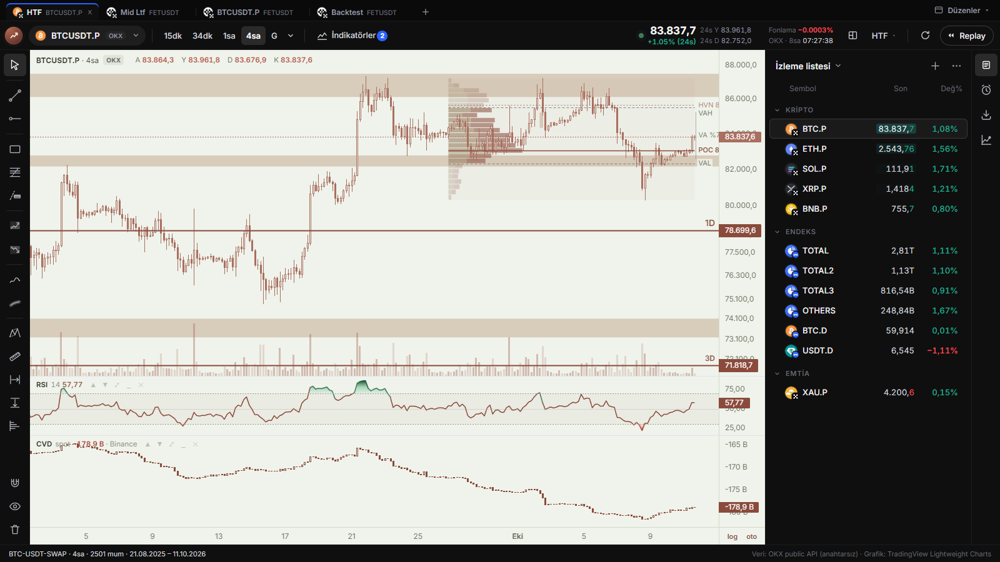
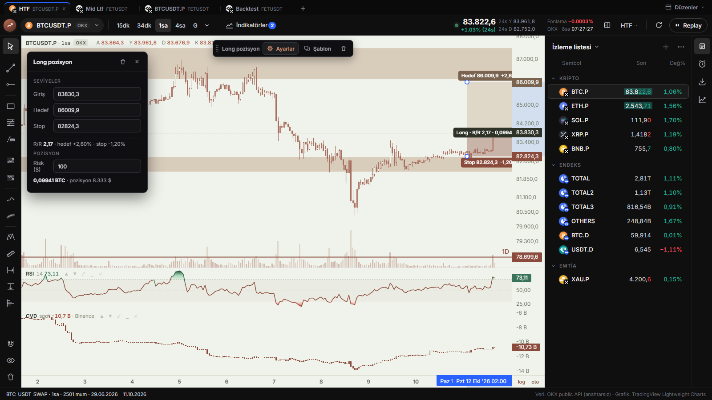
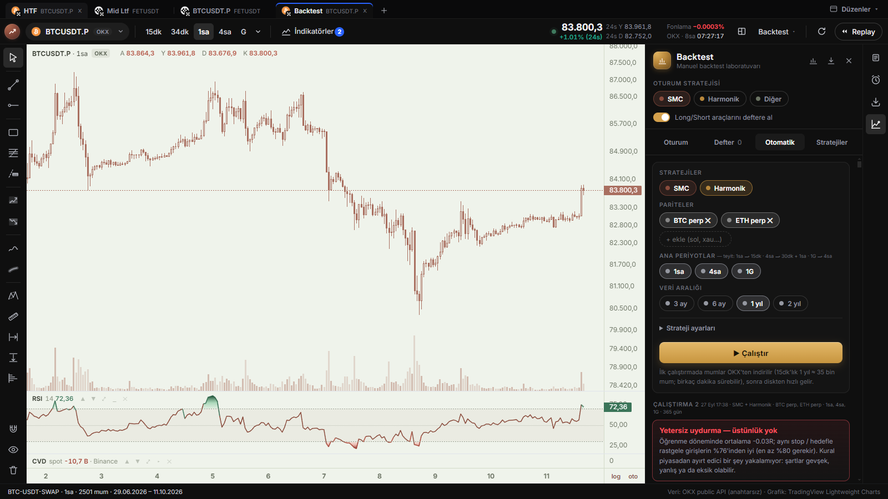
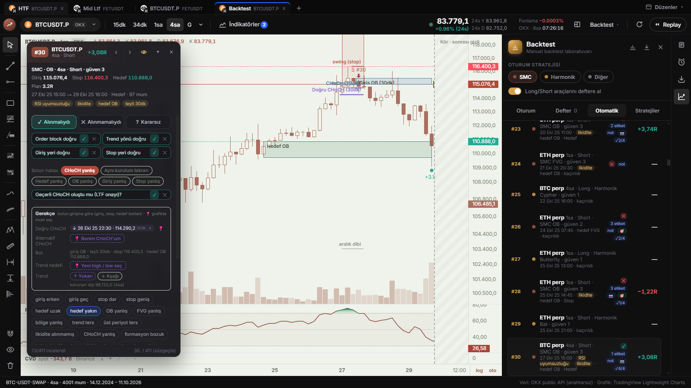
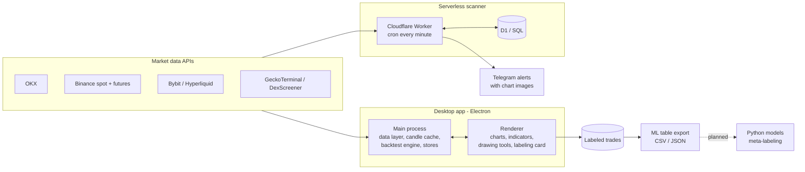

# Wickform

**Market data analytics and a machine-learning labeling platform for crypto and commodity markets.**

Wickform is a desktop charting terminal with a serverless market scanner and a backtest engine. Its main goal is to build a **leakage-free, well-labeled dataset** of trade setups. That dataset will be used to train models that decide which setups are worth taking (*meta-labeling*).

It is a decision-support tool. It produces signals and analysis, and it never places orders.

> The source code is private. This repository is a showcase: what the system does, how it is built, and what the data has shown so far.

---

## Highlights

- **Multi-source market data.** Candles, funding and taker volume from OKX, Binance (spot and futures), Bybit and Hyperliquid. DEX pairs come from GeckoTerminal and DexScreener. Local cache, live streams, and replay of any past period.
- **Serverless scanner.** A Cloudflare Worker with a SQL (D1) store runs every minute while the desktop app is closed. It detects RSI divergence, market-structure breaks (CHoCH / BOS) and volume spikes, and sends Telegram alerts with a rendered chart.
- **Backtest engine.** Two rule-based strategies (Smart-Money-Concepts structure and harmonic patterns) run across symbols, three timeframes and one year of data. The current run produced **411 trades**. Each run is compared with **random entries that use the same stop and target**: a rule set has to beat at least 80 % of them before it counts as having an edge.
- **Labeling system for ML.** Every trade is reviewed in a labeling card:
  - a decision label (*take / skip*), kept separate from the *strategy's mistakes* (wrong CHoCH, wrong zone, wrong stop…);
  - numeric, chart-anchored reasons (entry zone, confirmation timeframe, stop swing, target, trend, alternative entry with exact prices);
  - an explicit rule check that flags labels contradicting the reviewer's own rule.
- **Leakage controls.**
  - *Blind review*: the chart is masked after the trade's exit. A first audit found that every trade labeled "should take" without masking (5 of 5) was a winner. That is outcome leakage.
  - *Hold-out exam period*: setups after 1 July 2026 are locked; their results stay hidden until the end.
  - *Walk-forward* evaluation is planned for every model.
- **Verified calculations.** Every module that computes money, risk or indicator values is checked against an independent second calculation. ~1,700 automated tests.

## Screenshots

| Position sizing from risk | Backtest runner |
|---|---|
|  |  |

**Labeling card**: decision, rule checklist, strategy errors, LTF confirmation, chart-anchored reasons:

## Architecture

## What the data has shown so far

Each claim below was measured on the project's own data before any feature built on it was kept. Method and full tables: [`analysis/FINDINGS.md`](analysis/FINDINGS.md). The labeled dataset and a 30-trade sample: [`analysis/DATASET.md`](analysis/DATASET.md).

| Question | Data | Result |
|---|---|---|
| Does RSI divergence alone give an edge? | 20 coins · ~4 years daily, ~1 year 4h · confirmation delay 1/2/3/5 bars | No. Win rate 10 bars later 48–58 %, mean return negative for every delay (−4.9 % to −0.6 %). RSI is kept only as a confirmation feature. |
| Can candle colour approximate volume delta (CVD)? | Binance spot, 30 days hourly, vs. real taker data | Correlation 0.51–0.65. Over multiple days the sign was even reversed for BTC. Switched to real taker volume. |
| Spot or futures CVD for divergences? | Binance taker, 15 coins, 4h, ~1.4 years | Spot divergence pointed in the right direction slightly more often than futures. Futures-only divergence was the weakest. Spot is the default. |
| Do the baseline rule sets have an edge? | 411 backtest trades, learning vs. test split | Not yet. They beat 76 % of random entries; 80 % is required. That is the reason for the labeling and meta-labeling work. |

## Machine-learning roadmap

The plan goes one step at a time. A step is kept only if it holds up on out-of-sample data.

1. **Label quality**: finish the unlocked setups (in progress, 73 / 411 reviewed). See [`analysis/DATASET.md`](analysis/DATASET.md).
2. **Exploratory analysis**: which features separate *take* from *skip*: trend, liquidity sweep, RSI divergence, OTE zone, higher-timeframe alignment.
3. **Baseline models**: logistic regression, then gradient boosting (LightGBM). Class weights for imbalance, SHAP for explanations.
4. **Validation**: purged walk-forward, then the locked exam period.
5. **Neural networks**: a perceptron and an MLP written from scratch in NumPy, then PyTorch.
6. **Sequence models**: 1D CNN / LSTM on raw candle sequences, with pre-training on unlabeled data and fine-tuning on labels.

## Tech stack

JavaScript (Node.js, Electron) · Lightweight Charts · Cloudflare Workers · SQL (D1 / SQLite) · REST & WebSocket APIs · Telegram Bot API · planned: Python (pandas, scikit-learn, PyTorch)

---

## Türkçe özet

Wickform, kripto ve emtia piyasaları için bir **grafik terminali, sunucusuz piyasa tarayıcısı ve backtest motorudur**. Asıl amacı, makine öğrenmesi için **sızıntısız ve iyi etiketlenmiş bir işlem veri seti** kurmak: strateji aday işlem üretir, model hangisinin alınacağına karar verir (meta-etiketleme). Emir göndermez; karar destek amaçlıdır.

- Altı veri kaynağı: OKX, Binance, Bybit, Hyperliquid, GeckoTerminal, DexScreener.
- Cloudflare Workers ve SQL (D1) üzerinde dakikalık tarama, grafikli Telegram bildirimi.
- 2 strateji ve 411 işlemlik backtest; her çalıştırma aynı stop ve hedefle rastgele girişlerle karşılaştırılıyor.
- Etiketleme sistemi:
  - kör inceleme (sonuç sızıntısı ölçülüp giderildi);
  - kilitli sınav dönemi;
  - "kurulum geçerli mi" ile "strateji neyi yanlış yaptı" sorularının ayrılması;
  - grafikteki mumlara bağlı sayısal gerekçeler.
- Ölçülen bulgular: RSI uyumsuzluğu tek başına avantaj vermiyor; mum rengiyle tahmin edilen CVD gerçek veriyle zayıf ilişkili (0,51–0,65); spot CVD vadeliden biraz daha iyi yön veriyor.
- Sıradaki aşama: keşifsel analiz → lojistik regresyon / LightGBM → walk-forward doğrulama → sinir ağları.

**Geliştirici:** Çağrı Yüksel · Endüstri Mühendisi, Veri Bilimi Yüksek Lisans (Dokuz Eylül Üniversitesi) · [LinkedIn](https://www.linkedin.com/in/cagri-yuksell)
